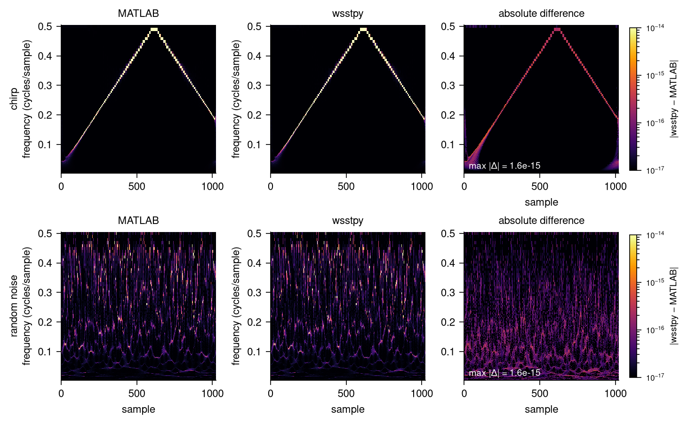
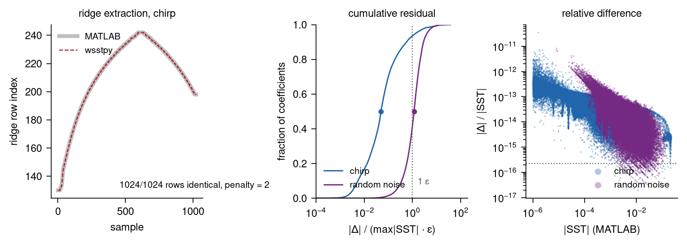

# wsstpy

Wavelet synchrosqueezing in Python, with the same numerical behaviour as the
MATLAB functions of the Wavelet Toolbox:

| MATLAB | wsstpy |
| --- | --- |
| `wsst(x)` | `wsstpy.wsst(x)` |
| `iwsst(sst)` | `wsstpy.iwsst(sst)` |
| `wsstridge(sst)` | `wsstpy.wsstridge(sst)` |
| `cwt(x)` | `wsstpy.cwt(x)` |
| `icwt(cfs)` | `wsstpy.icwt(cfs)` |
| `cwtfilterbank` | `wsstpy.CWTFilterBank` |

## How close it is

Checked against MATLAB R2025b on signals of length 256 to 4096, at several
voices per octave, with the Morlet, Morse and bump wavelets:

| quantity | maximum difference |
| --- | --- |
| `wsst` matrix, Morlet | 2.5e-15 absolute, 1.1e-14 relative |
| `wsst` matrix, Morse and bump | 2.6e-15 absolute, 2.7e-14 relative |
| `cwt` coefficients | 2.2e-14 absolute |
| `iwsst` / `icwt`, Morse | 6.3e-15 absolute |
| `iwsst` / `icwt`, Morlet | 3.5e-07 absolute, 7.2e-08 relative |
| `wsstridge` row indices | identical in every case tested |

The Morlet inverse differs at 1e-8 relative because MATLAB evaluates the
admissibility constant with `integral`'s default relative tolerance of 1e-6
and stops the integration at `sqrt(eps)`, where the integrand diverges. The
constant recovered from MATLAB's own output is 0.861027604938177, wsstpy
computes 0.8610275430057707, and the latter was confirmed by two independent
quadrature methods. The full tables, every individual case, are in
[VALIDATION.md](VALIDATION.md) together with the scripts that produced them.



The two left columns are the same matrix computed twice, once in MATLAB and
once here, for a chirp and for random noise (1024 samples). They are drawn on
identical colour scales. The right column is the absolute difference, on a log
scale from 1e-17 to 1e-14: it peaks at 1.6e-15 and follows the ridge, which is
where the coefficients are largest. Empty cells are zero in both.



Left: the ridge MATLAB finds and the ridge wsstpy finds, drawn as a wide grey
line and a thin dashed red line. Every one of the 1024 row indices is equal.
Centre: the cumulative distribution of the residual, measured in machine
epsilon of the peak coefficient. Half the coefficients of the chirp are within
0.05 epsilon of the peak and 99 percent within 7 epsilon; the largest residual
of either case is 38 epsilon, which is 1.6e-15 in absolute terms. Right: the
relative difference of every coefficient above 1e-6, all below 1e-14.

To be precise about the word identical: quantities that are discrete, such as
ridge row indices, come out exactly equal. Continuous quantities agree to a
few units in the last place, not bit for bit, because MATLAB and NumPy sum the
reassembled coefficients in a different order and use different FFT code. A
tiny fraction of coefficients, 0.02 percent of the non-zero ones, happen to be
equal to the last bit.

Regenerate the figures with `python scripts/make_validation_figure.py`, which
needs the MATLAB reference files in `probe/data5` and `probe/data6`.

## Why this exists

MATLAB's `wsst` lives in the Wavelet Toolbox, which needs a paid licence and
cannot be redistributed. Synchrosqueezing itself is published mathematics
(Daubechies, Lu and Wu 2011; Thakur, Brevdo, Fuckar and Wu 2013). This package
implements that mathematics in NumPy so the same analysis runs in scripts,
pipelines and on servers without MATLAB.

## Install

```bash
pip install git+https://github.com/Halhousni/wsstpy.git
```

Requires Python 3.9 or newer, NumPy and SciPy. Matplotlib is needed only for
the plotting examples. From a checkout:

```bash
git clone https://github.com/Halhousni/wsstpy
cd wsstpy
pip install -e ".[dev]"
pytest
```

The package is not on PyPI yet.

## Quick start

```python
import numpy as np
import wsstpy

fs = 1000.0
k = np.arange(2000)
x = np.cos(2 * np.pi * 50 * k / fs) + 0.7 * np.cos(2 * np.pi * 180 * k / fs)

sst, f = wsstpy.wsst(x, fs)
row = np.argmax(np.abs(sst).sum(axis=1))
print(f"strongest row: {f[row]:.1f} Hz")

# ridges, then one reconstruction per ridge
fridge, iridge = wsstpy.wsstridge(sst, penalty=0.5, num_ridges=2, f=f)
components = wsstpy.iwsst(sst, ridge_indices=iridge)   # shape (2000, 2)

# the whole signal back
xrec = wsstpy.iwsst(sst)
```

A chirp with its ridge drawn on top:

```python
import matplotlib.pyplot as plt

fs = 500.0
t = np.arange(0, 4, 1 / fs)
x = np.cos(2 * np.pi * (20 * t + 12.5 * t**2))
sst, f = wsstpy.wsst(x, fs)

plt.pcolormesh(t, f, np.abs(sst), shading="auto", cmap="magma")
plt.ylim(0, 150)
plt.xlabel("time (s)")
plt.ylabel("frequency (Hz)")
plt.show()
```

`python examples/plot_sst.py` and `python examples/separate_tones.py` are
longer versions. The second recovers two overlapping tones from a single
channel with a maximum error of 3e-4 against the true components.

## Functions

`wsst(x, fs=None, wavelet="amor", voices_per_octave=32, extend_signal=False, wavelet_parameters=None)`
: Forward transform. Returns the complex `(n_scales, n)` matrix with rows
  ordered from low to high frequency, and the frequency of each row.
  `wavelet` is `"amor"` (analytic Morlet), `"morse"` or `"bump"`.

`iwsst(sst, f=None, freq_range=None, wavelet="amor", ridge_indices=None, num_frequency_bins=16)`
: Inverse transform. Reconstructs the whole signal, one frequency band, or one
  signal per ridge.

`wsstridge(sst, penalty=0.0, num_ridges=1, num_frequency_bins=4, f=None)`
: Ridges by dynamic programming. `penalty` multiplies the squared change in
  row index between samples. Zero allows jumps, larger values give smoother
  curves.

`cwt(x, fs=None, wavelet="morse", voices_per_octave=10, extend_signal=True, frequency_limits=None)`
: Continuous wavelet transform, with MATLAB's default band, defaults and
  normalisation.

`icwt(cfs, fs=None, wavelet="morse", voices_per_octave=None, f=None, freq_range=None)`
: Inverse CWT, with optional band limitation.

`CWTFilterBank(signal_length, voices_per_octave=32, wavelet="amor", sampling_frequency=1.0, frequency_limits=None, boundary="periodic")`
: The filter bank alone. Exposes `scales`, `psi_dft`, `center_frequencies`,
  `omega` and `pad`, so filters can be reused across signals.

## How it works

1. Filter bank. For each scale on a geometric grid, store the wavelet's
   Fourier transform on the FFT grid. Filters peak at magnitude 2, the L1
   normalisation MATLAB uses. The finest scale comes from the top of the band,
   the coarsest from the signal length and the wavelet's time-domain width.
2. Analysis. Multiply the signal's FFT by each filter to get the CWT, and by
   `1j * omega` times each filter to get its derivative.
3. Phase transform. `imag(dCWT / CWT) / (2 pi)` is the instantaneous frequency
   of each coefficient in cycles per sample. Negative and non-finite values
   become zero.
4. Reassignment. Each coefficient moves to the row whose centre frequency is
   nearest on a log scale, accumulating `log(2) / voices_per_octave`.
   Coefficients below `sqrt(eps)` in magnitude are dropped, as in MATLAB.

Ridges maximise the sum of `-log|SST|` along a path, with a penalty on the
squared row change:

```
D[n, i] = E[n, i] + min_j ( D[n-1, j] + penalty * (i - j)^2 )
```

The recurrence is solved column by column. For several ridges, the rows around
each extracted ridge are removed from the cost before the next search.

## Differences from MATLAB

- `voices_per_octave` accepts any even integer of 2 or more. MATLAB restricts
  it to 10 through 48. For the same value the results agree.
- `ScalingCoefficients` and the low-pass boundary term of `cwt` are not
  implemented. Use `extend_signal=True`, MATLAB's default, for boundary
  handling.
- Calling `wsst` with no output arguments plots in MATLAB. Here it always
  returns arrays, and plotting is left to Matplotlib.
- `icwt` does not accept time tables.

## Licence

MIT, see [LICENSE](LICENSE).

This is not affiliated with MathWorks and contains no MATLAB source code. It
is an implementation of the published synchrosqueezing algorithm, written from
the papers and matched numerically against the behaviour of the MATLAB
functions.

## References

- I. Daubechies, J. Lu, H.-T. Wu. Synchrosqueezed wavelet transforms: an
  empirical mode decomposition-like tool. Applied and Computational Harmonic
  Analysis 30(2), 2011.
- G. Thakur, E. Brevdo, N. S. Fuckar, H.-T. Wu. The synchrosqueezing algorithm
  for time-varying spectral analysis: robustness properties and new
  paleoclimate applications. Signal Processing 93(5), 2013.
- H.-T. Wu, J. Fajardo-Lira. The synchrosqueezing algorithm for time-varying
  spectral analysis. 2011.
